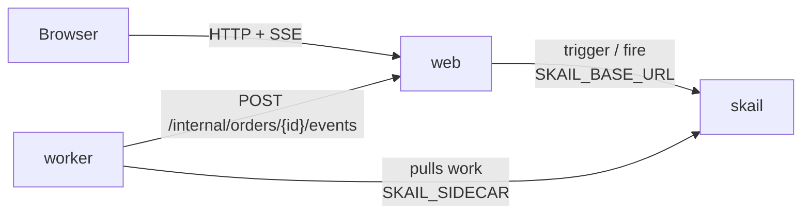

# skail purchase approval (.NET 8)

[Português (Brasil)](README.pt-BR.md)

A skail function asks the manager to approve a purchase order and waits for the decision until a deadline. With no answer it escalates to the director and waits again; with no answer again, it cancels the order. The deadlines are 1 minute in this demo and 48 hours in a real approval, with the same code. A web page places the order and has **Approve** and **Reject** buttons for the level that is waiting.

The demo covers three topics of the [skail docs](https://docs.skail.dev) (in Portuguese):

- an [external event](https://docs.skail.dev/construa/conceitos/eventos-externos-e-correlacao) that brings the decision into the run;
- the [wait with a deadline](https://docs.skail.dev/construa/como-fazer/esperar-um-evento-com-prazo) pattern: the event or the delay, whichever comes first;
- [human-in-the-loop](https://docs.skail.dev/construa/como-fazer/padroes-e-antipadroes/human-in-the-loop), with an escalation when nobody answers.

## How it works



- **worker** (`src/SkailPurchaseApproval.Worker`): the function `ApprovePurchase(purchase, managerDeadlineSeconds, directorDeadlineSeconds)` in `PurchaseFunctions.cs` and its commands in `PurchaseCommands.cs`. `RequestApproval` asks a level to decide; `ConfirmPurchase`, `RejectPurchase` and `CancelForNoResponse` end the order; `ReportStatus` tells the page how the run is going. The commands delegate to `PurchaseOperations`, so their logic is tested without skail.
- **web** (`src/SkailPurchaseApproval.Web`): static page and API. It starts the run (trigger), records each decision from the level that is waiting and sends it to the run (fire), keeps the state in memory and streams it to the page (SSE).
- **contracts** (`src/SkailPurchaseApproval.Contracts`): types and constants used by the worker and the web app.

The function only orchestrates and leaves the I/O to the commands. It creates one wait for `PURCHASE_DECISION` and reuses it in both `WhenAny`, one per deadline. `WhenAny` returns the task that finished first, and the function compares it with the wait. Simplified from [`PurchaseFunctions.cs`](src/SkailPurchaseApproval.Worker/PurchaseFunctions.cs), which also reports each stage to the page:

```csharp
await commands.RequestApproval(purchase, Levels.Manager);
var decision = SkailTask.WaitForEvent<Decision>(Events.PurchaseDecision, purchase.Id);

var winner = await SkailTask.WhenAny(decision, SkailTask.Delay(TimeSpan.FromSeconds(managerDeadlineSeconds)));
if (winner != decision)
{
    await commands.RequestApproval(purchase, Levels.Director);   // escalation
    winner = await SkailTask.WhenAny(decision, SkailTask.Delay(TimeSpan.FromSeconds(directorDeadlineSeconds)));
}

if (winner != decision)
    return await commands.CancelForNoResponse(purchase);

var answer = await decision;
return answer.Approved
    ? await commands.ConfirmPurchase(purchase, answer)
    : await commands.RejectPurchase(purchase, answer);
```

The function decides by the task that `WhenAny` returned, not by `decision.IsCompleted`: on a resume, `IsCompleted` already sees a decision that arrived after the deadline.

## The paths

The page has a **Request approval** button and one card per level, with **Approve** and **Reject**.

| What you do | What happens | Result |
|---|---|---|
| **Approve** as Manager | approved at once, without waiting for the deadline | **Approved**, with a reference `PO-…` |
| **Reject** as Manager | rejected, with the reason you typed | **Rejected** |
| nothing for 1 minute, then **Approve** as Director | the order escalates to the director, who approves it | **Approved** |
| nothing for 2 minutes | the order is cancelled for no response, which is different from a rejection | **Cancelled** |

A decision from the level that is not waiting (the manager after the escalation), a second decision or a decision after the end gets `409`. The first decision wins, and no second event is sent. The countdown on the cards is only visual: the real deadline is the durable delay in skail, which holds no thread or process.

## How it connects to skail

| Service | Variable | Used for |
|---|---|---|
| worker | `SKAIL_SIDECAR` | Connects the function to your environment and receives its work. |
| web | `SKAIL_BASE_URL` | Starts runs and sends the decisions through the skail HTTP API. |

Both use the same `SKAIL_WORKLOAD`, `SKAIL_NAMESPACE` and `SKAIL_KEY`. The web app makes two calls:

```http
POST {SKAIL_BASE_URL}/api/v1/trigger/{name}/{version}/ApprovePurchase/{orderId}
[{"Id": "{orderId}", "Supplier": "Papelaria Central", "Description": "A4 paper reams (50 boxes)", "Amount": 18500}, 60, 60]

POST {SKAIL_BASE_URL}/api/v1/fire/PURCHASE_DECISION/{orderId}
{"Level": "manager", "Approved": true, "By": "Maria", "Reason": null, "At": "2026-11-03T22:00:00+00:00"}
```

`{name}` and `{version}` come from `SKAIL_WORKLOAD` (`name:version`). The bodies use the property names as C# declares them. Each call sends the key in `skail-key` and in `Authorization: Bearer`, plus the `Skail-namespace` header, as described in [authentication](https://docs.skail.dev/referencia/api-http/autenticacao). `429`, `5xx` and network errors are retried with the same order id. `401` and `403` are not retried: check `SKAIL_KEY` and `SKAIL_NAMESPACE`.

The two numbers at the end of the trigger are the deadlines, in seconds. They are arguments of the function, so they go into the run history and stay fixed for that run. The web app reads them from `APPROVAL_MANAGER_DEADLINE_SECONDS` and `APPROVAL_DIRECTOR_DEADLINE_SECONDS` (60 by default); use `172800` for 48 hours.

The browser never calls skail. It only talks to the web app, so the key stays on the server.

## Requirements

- .NET 8 SDK
- podman or docker
- PowerShell 7+ (`pwsh`), only if you use `scripts/run.ps1` instead of `scripts/run.sh`
- A skail environment with the workload from `SKAIL_WORKLOAD` registered (`purchaseapproval:v1.0.0` by default). The [Quickstart](https://docs.skail.dev/comece-aqui/quickstart) shows how to get an account, create the environment and register the workload.
- A current browser (Chrome/Edge 111+, Firefox 113+, Safari 16.2+). The page uses Server-Sent Events, CSS `color-mix()` and modern JavaScript.

## Configure

```bash
cp .env.example .env     # .env holds the key and is ignored by git
```

Fill in `SKAIL_WORKLOAD` (exactly as registered in the portal), `SKAIL_NAMESPACE`, `SKAIL_KEY`, `SKAIL_SIDECAR` and `SKAIL_BASE_URL` with the values of your environment.

The deadlines belong to the web app, so changing them only needs a restart of the web app.

## Run with podman or docker

```bash
scripts/run.sh up        # builds both images and starts web + worker
scripts/run.sh logs
scripts/run.sh down
```

`CONTAINER_ENGINE=docker` forces docker. On Windows, or anywhere with PowerShell 7+, run `pwsh scripts/run.ps1 <command>` with the same commands; `$env:CONTAINER_ENGINE = "docker"` forces docker.

Open <http://localhost:8080> and press **Request approval**.

### See the durability

1. Press **Request approval** and wait for the Manager card to show **Pending**.
2. Run `scripts/run.sh kill-worker`. It kills the worker with SIGKILL, like a crash; the web app keeps the page state.
3. Wait for the manager deadline to pass with the worker down, then run `scripts/run.sh start-worker`.
4. The escalation happens when the worker comes back, and the manager is not asked again.

In the portal, open the [Monitor](https://docs.skail.dev/referencia/portal/monitor) of your environment and search for the order id. The run lists `ReportStatus` and `RequestApproval`, each wait as a `WhenAny` with its `Delay`, and the command that ended the order. The `WaitForEvent` for `PURCHASE_DECISION` shows up once, inside the first `WhenAny`, because the function creates that wait once and reuses it. The log lines of the commands show up between the steps, such as `Approval requested from the director: …`. On an escalated order, **E2E Duration** goes past the manager deadline while **Duration** stays short, because the waits do not use the worker. A cancelled order also shows as **Completed**, because the function returns normally; its result says how the order ended (`end: "Cancelled"`).

## VS Code

Open the folder and accept the recommended extensions (C# Dev Kit).

- `Ctrl+Shift+B` builds, the *test* task runs the tests and the `containers: up/down/logs/kill-worker/start-worker` tasks call `scripts/run.sh`.
- The **Worker + Web** debug configuration starts both projects reading `.env`, and a breakpoint inside a command works. Outside containers, the worker reaches the web app on `localhost` (`WEB_BASE_URL`, set in `launch.json`).

## Tests

```bash
dotnet test
```

The unit tests cover the contracts, the operations behind the commands, the order store (decision by level, wrong level, one decision, undo when the event could not be sent), the calls to skail (trigger, fire and retries) and the web API with SSE. They need neither network nor skail. The function itself runs against skail, in the end-to-end tests below.

### End-to-end tests

`e2e/` has a Playwright suite that drives the real page in Chromium, the real web app and a real worker against your skail environment (the `.env` of this folder), with 10-second deadlines. It covers manager approval and rejection, escalation with a director approval or rejection (and `409` for the manager after it), cancellation for no response, a page reload in the middle of an order, a worker killed while the order waits and a decision made while the worker is down.

The suite needs Node 20 or later and pnpm 10, besides the .NET 8 SDK.

```bash
cd e2e
pnpm install
pnpm exec playwright install chromium   # first time only
pnpm exec playwright test               # builds the solution, then runs the suite
```

It needs a workload that no other worker is serving: stop the containers (`scripts/run.sh down`) and any other worker with the same `SKAIL_WORKLOAD` before running.

## Notes

- The same event serves both levels, so a manager decision that arrives after the escalation would be taken by the second wait. The web app refuses it with `409`, but only while its memory is up: an event sent straight to the skail API, or after a restart of the web app, does not pass through that check.
- After a cancellation the wait stays without an answer on purpose, and the web app refuses new decisions with `409`.
- The order state lives in the memory of the web app. Restarting it loses the page history; the order keeps running in skail, but the web app ignores the progress of orders it does not know.
- "Decided by" is free text, and the `POST /internal/orders/{id}/events` route, which the worker calls, has no authentication. That is fine for a local demo; protect both before using the pattern in production.
- Workers with the same `SKAIL_WORKLOAD` on the same environment share the same runs: use one workload (or environment) per person.

## License

[Apache-2.0](LICENSE)
