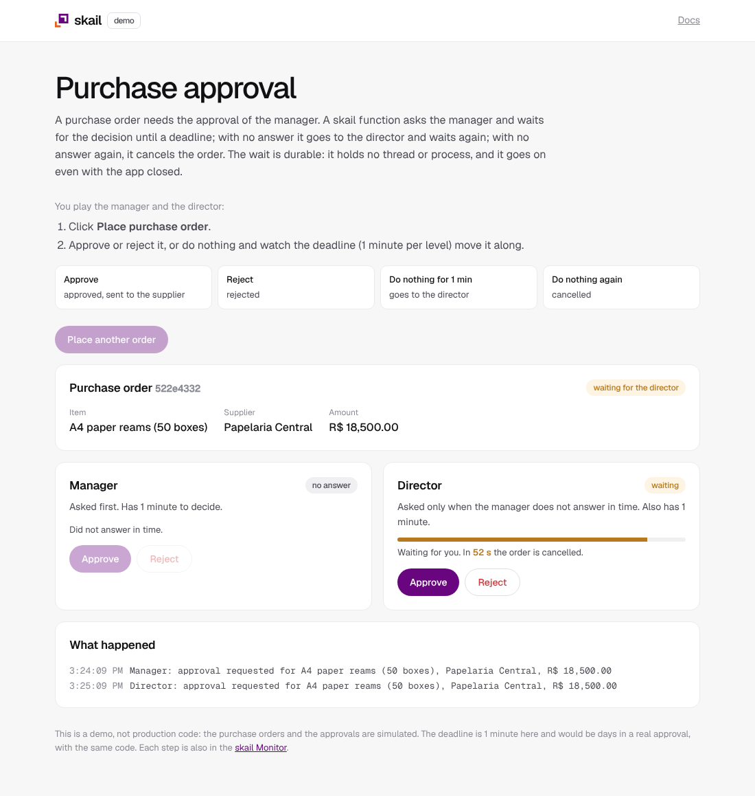

# skail purchase approval (.NET 8)

[Português (Brasil)](README.pt-BR.md)

An app with a skail function that asks the manager to approve a purchase order and waits for the decision until a deadline. With no answer it escalates to the director and waits again; with no answer again, it cancels the order. The deadlines are 1 minute here and 48 hours in a real approval, with the same code. You play the manager and the director on a page the app serves at http://localhost:8080.

It shows three skail features:

- an **external event** (`PURCHASE_DECISION`) that brings the decision into the run;
- the **wait with a deadline**: the decision or the deadline, whichever comes first, with an escalation when nobody answers;
- **durability**: close the app while the order waits, start it again and the order goes on, with the same deadlines.

## Requirements

- One of: [Docker](https://docs.docker.com/get-docker/), [Podman](https://podman.io/docs/installation) or the [.NET 8 SDK](https://dotnet.microsoft.com/download/dotnet/8.0) (or newer). The run script uses the first one it finds.
- A skail environment with a workload registered for the `SKAIL_WORKLOAD` in `.env` (`purchaseapproval:v1.0.0` by default). The [Quickstart](https://docs.skail.dev/comece-aqui/quickstart) shows how to create the account, the environment and the workload.

The project uses `Skail.Platform.Runtime` **2.3.0-rc.4**.

## Run

```bash
cp .env.example .env  # fill in SKAIL_SIDECAR, SKAIL_NAMESPACE and SKAIL_KEY (portal > Environments & keys > Connect)
scripts/run.sh        # then open http://localhost:8080
```

On Windows, in PowerShell: `copy .env.example .env`, then `powershell -ExecutionPolicy Bypass -File scripts\run.ps1` with the same arguments. The script works on the Windows PowerShell built into Windows; PowerShell 7 is not needed.

The script runs the demo with what the machine has: Docker, then Podman, then the .NET SDK. If it finds none of them, it says what to install. Without the script, the commands are `dotnet run` (with the arguments after `--`, as in `dotnet run -- <argument>`).



Each step the commands take shows up on the page, under **What happened**, and in the console. The buttons send the events to the run, and the page refreshes itself every second.

## The paths

| What you click | What happens | Result |
|---|---|---|
| **Place purchase order**, then **Approve** as Manager | approved at once, without waiting for the deadline | `approved PO-…` |
| **Reject** as Manager | rejected | `rejected` |
| nothing for 1 minute, then **Approve** as Director | the order escalates to the director, who approves it | `approved PO-…` |
| nothing for 1 minute, then **Reject** as Director | the order escalates to the director, who rejects it | `rejected` |
| nothing for 2 minutes | cancelled for no response, which is different from a rejection | `cancelled` |

Only the level the order is waiting for has its buttons on: the director's turn on only after the escalation.

## How it works

The app does three jobs in one process: it serves the page, it hosts the worker that runs the function (`builder.UseSkail()`), and it places the order and turns the buttons into the decision event, through the skail HTTP API. The commands report each step to a timeline the page shows:

```http
POST {SKAIL_SIDECAR}/api/v1/trigger/purchaseapproval/v1.0.0/ApprovePurchase/{orderId}
[{"Id": "{orderId}", "Supplier": "Papelaria Central", "Description": "A4 paper reams (50 boxes)", "Amount": 18500}, 60, 60]

POST {SKAIL_SIDECAR}/api/v1/fire/PURCHASE_DECISION/{orderId}
{"Level": "director", "Approved": false, "By": "Director", "Reason": "over the budget", "At": "2026-11-17T18:05:12Z"}
```

The function, in [`PurchaseFunctions.cs`](PurchaseFunctions.cs):

```csharp
[SkailFunction]
public async SkailTask<string> ApprovePurchase(PurchaseOrder purchase, int managerDeadlineSeconds, int directorDeadlineSeconds)
{
    await RequestApproval(purchase, Levels.Manager);

    var decision = SkailTask.WaitForEvent<Decision>(Events.PurchaseDecision, purchase.Id);

    var winner = await SkailTask.WhenAny(decision, SkailTask.DelaySeconds((ulong)managerDeadlineSeconds));
    if (winner != decision)
    {
        await RequestApproval(purchase, Levels.Director);   // escalation
        winner = await SkailTask.WhenAny(decision, SkailTask.DelaySeconds((ulong)directorDeadlineSeconds));
    }

    if (winner != decision)
        return await CancelForNoResponse(purchase);

    var answer = await decision;
    return answer.Approved
        ? await ConfirmPurchase(purchase, answer)
        : await RejectPurchase(purchase, answer);
}
```

- The wait for `PURCHASE_DECISION` is created once and reused in both `WhenAny`, one per deadline.
- The function decides by the task `WhenAny` returned, not by `decision.IsCompleted`: on a resume, `IsCompleted` already sees a decision that arrived after the deadline.
- The commands only print what would happen in the purchasing system.

| File | What it has |
|---|---|
| `PurchaseFunctions.cs` | The function and its commands. |
| `Model.cs` | The levels, the event name, the order and the decision (the payload of the event). |
| `Demo/PurchaseDesk.cs` | Places the order and turns each button into the decision event. |
| `Demo/Timeline.cs` | The timeline of the steps, for the console and the page. |
| `Page/index.html` | The page, with the skail branding. |
| `Skail/SkailApiClient.cs` | Trigger and fire through the skail HTTP API. |
| `Program.cs` | Reads `.env` and the argument, serves the page and its API, and wires everything up. |
| `scripts/run.sh`, `scripts/run.ps1`, `Dockerfile` | Run the demo with Docker, Podman or .NET, whatever the machine has. |

## See the durability

1. Run `scripts/run.sh`, open the page, place an order and wait for `Manager: approval requested`.
2. Press **Ctrl+C**. The app closes; the order stays in skail, waiting for the manager.
3. Start the app again with the order id shown on the page and in the console: `scripts/run.sh <order id>`. With an id, the app places no new order: it only hosts the worker again and follows that order.
4. One minute after the order was placed, it escalates to the director on schedule, even though the app was closed for part of that minute. Open the page and click **Approve** as Director.

In the portal, open the [Monitor](https://docs.skail.dev/referencia/portal/monitor) of your environment and click the run: it lists `RequestApproval` for the manager, the wait for `PURCHASE_DECISION` with its `Delay`, the escalation and the command that ended the order.

## Notes

- Apps running the same `SKAIL_WORKLOAD` on the same environment share the same runs: use one workload (or environment) per person.

## Disclaimer

**This is a demo, not production code.** It exists only to show how [skail](https://docs.skail.dev) works and is provided "as is", without warranty of any kind. The purchase orders and the approvals are simulated.

## License

[Apache-2.0](LICENSE)
