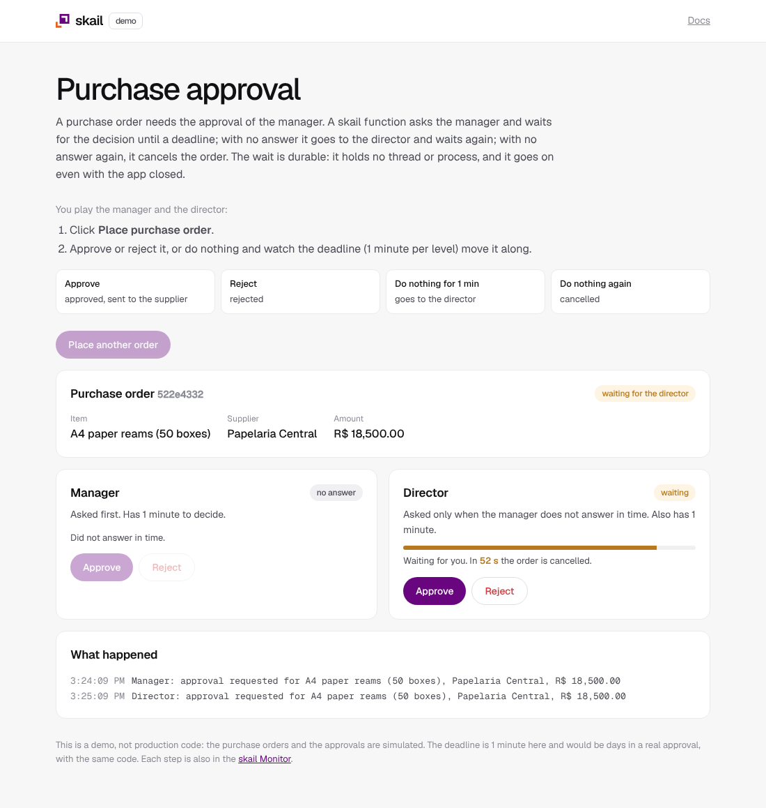

# skail purchase approval (.NET 8)

[English](README.md)

Um app com uma function do skail que pede ao gerente para aprovar um pedido de compra e espera a decisão até um prazo. Sem resposta, ela escala para o diretor e espera de novo; sem resposta de novo, cancela o pedido. Os prazos são de 1 minuto aqui e de 48 horas numa aprovação real, com o mesmo código. Você faz o papel do gerente e do diretor numa página que o app serve em http://localhost:8080.

Ele mostra três recursos do skail:

- um **evento externo** (`PURCHASE_DECISION`) que traz a decisão para a execução;
- a **espera com prazo**: a decisão ou o prazo, o que vier primeiro, com escalonamento quando ninguém responde;
- **durabilidade**: feche o app enquanto o pedido espera, abra de novo e o pedido continua, com os mesmos prazos.

## Requisitos

- Um destes: [Docker](https://docs.docker.com/get-docker/), [Podman](https://podman.io/docs/installation) ou o [SDK do .NET 8](https://dotnet.microsoft.com/download/dotnet/8.0) (ou mais novo). O script de execução usa o primeiro que encontrar.
- Um environment do skail com um workload registrado para o `SKAIL_WORKLOAD` do `.env` (`purchaseapproval:v1.0.0` por padrão). O [Quickstart](https://docs.skail.dev/comece-aqui/quickstart) mostra como criar a conta, o environment e o workload.

O projeto usa o `Skail.Platform.Runtime` **2.3.0-rc.4**.

## Rodar

```bash
cp .env.example .env  # preencha SKAIL_SIDECAR, SKAIL_NAMESPACE e SKAIL_KEY (portal > Environments & keys > Connect)
scripts/run.sh        # depois abra http://localhost:8080
```

No Windows, no PowerShell: `copy .env.example .env` e depois `powershell -ExecutionPolicy Bypass -File scripts\run.ps1`, com os mesmos argumentos. O script funciona no Windows PowerShell que já vem no Windows; não precisa do PowerShell 7.

O script roda a demo com o que a máquina tiver: Docker, depois Podman, depois o SDK do .NET. Se não achar nenhum, ele diz o que instalar. Sem o script, os comandos são `dotnet run` (com os argumentos depois de `--`, como em `dotnet run -- <argumento>`).



Você faz o papel do gerente e do diretor. A página mostra o pedido, um cartão para cada um com **Approve** e **Reject**, e uma barra com a contagem do prazo de quem está sendo esperado, dizendo o que acontece quando ele acaba. Os botões do diretor só ligam depois do escalonamento. Cada botão envia o evento da decisão para a execução; cada passo também aparece em **What happened** e no console, e a página se atualiza sozinha a cada segundo.

## Os caminhos

| O que você clica | O que acontece | Resultado |
|---|---|---|
| **Place purchase order**, depois **Approve** no gerente (Manager) | aprovado na hora, sem esperar o prazo | `approved PO-…` |
| **Reject** no gerente | recusado | `rejected` |
| nada por 1 minuto, depois **Approve** no diretor (Director) | o pedido escala para o diretor, que aprova | `approved PO-…` |
| nada por 1 minuto, depois **Reject** no diretor | o pedido escala para o diretor, que recusa | `rejected` |
| nada por 2 minutos | cancelado por falta de resposta, o que é diferente de uma recusa | `cancelled` |

Só o nível que o pedido está esperando tem os botões ligados: os do diretor só ligam depois do escalonamento.

## Como funciona

O app faz três coisas no mesmo processo: serve a página, hospeda o worker que executa a function (`builder.UseSkail()`) e cria o pedido e transforma os botões no evento de decisão, pela API HTTP do skail. Os commands registram cada passo numa linha do tempo que a página mostra:

```http
POST {SKAIL_SIDECAR}/api/v1/trigger/purchaseapproval/v1.0.0/ApprovePurchase/{orderId}
[{"Id": "{orderId}", "Supplier": "Papelaria Central", "Description": "A4 paper reams (50 boxes)", "Amount": 18500}, 60, 60]

POST {SKAIL_SIDECAR}/api/v1/fire/PURCHASE_DECISION/{orderId}
{"Level": "director", "Approved": false, "By": "Director", "Reason": "over the budget", "At": "2026-11-17T18:05:12Z"}
```

A function, em [`PurchaseFunctions.cs`](PurchaseFunctions.cs):

```csharp
[SkailFunction]
public async SkailTask<string> ApprovePurchase(PurchaseOrder purchase, int managerDeadlineSeconds, int directorDeadlineSeconds)
{
    await RequestApproval(purchase, Levels.Manager);

    var decision = SkailTask.WaitForEvent<Decision>(Events.PurchaseDecision, purchase.Id);

    var winner = await SkailTask.WhenAny(decision, SkailTask.DelaySeconds((ulong)managerDeadlineSeconds));
    if (winner != decision)
    {
        await RequestApproval(purchase, Levels.Director);   // escalation
        winner = await SkailTask.WhenAny(decision, SkailTask.DelaySeconds((ulong)directorDeadlineSeconds));
    }

    if (winner != decision)
        return await CancelForNoResponse(purchase);

    var answer = await decision;
    return answer.Approved
        ? await ConfirmPurchase(purchase, answer)
        : await RejectPurchase(purchase, answer);
}
```

- A espera por `PURCHASE_DECISION` é criada uma vez e reaproveitada nos dois `WhenAny`, um por prazo.
- A function decide pela task que o `WhenAny` devolveu, não pelo `decision.IsCompleted`: numa retomada, o `IsCompleted` já enxerga uma decisão que chegou depois do prazo.
- Os commands só imprimem o que aconteceria no sistema de compras.

| Arquivo | O que tem |
|---|---|
| `PurchaseFunctions.cs` | A function e os commands dela. |
| `Model.cs` | Os níveis, o nome do evento, o pedido e a decisão (o payload do evento). |
| `Demo/PurchaseDesk.cs` | Cria o pedido e transforma cada botão no evento de decisão. |
| `Demo/Timeline.cs` | A linha do tempo dos passos, para o console e a página. |
| `Page/index.html` | A página, com o branding do skail. |
| `Skail/SkailApiClient.cs` | Trigger e fire pela API HTTP do skail. |
| `Program.cs` | Lê o `.env` e o argumento, serve a página e a API dela e liga tudo. |
| `scripts/run.sh`, `scripts/run.ps1`, `Dockerfile` | Rodam a demo com Docker, Podman ou o .NET, o que houver na máquina. |

## Veja a durabilidade

1. Rode `scripts/run.sh`, abra a página, crie um pedido e espere o `Manager: approval requested`.
2. Aperte **Ctrl+C**. O app fecha; o pedido continua no skail, esperando o gerente.
3. Abra o app de novo com o id do pedido que aparece na página e no console: `scripts/run.sh <id do pedido>`. Com um id, o app não cria outro pedido: só hospeda o worker de novo e acompanha esse pedido.
4. Um minuto depois de o pedido ser criado, ele escala para o diretor no horário, mesmo com o app fechado durante parte desse minuto. Abra a página e clique em **Approve** no diretor.

No portal, abra o [Monitor](https://docs.skail.dev/referencia/portal/monitor) do seu environment e clique na execução: ela lista o `RequestApproval` do gerente, a espera por `PURCHASE_DECISION` com o seu `Delay`, o escalonamento e o command que encerrou o pedido.

## Observações

- Apps rodando o mesmo `SKAIL_WORKLOAD` no mesmo environment dividem as mesmas execuções: use um workload (ou environment) por pessoa.

## Aviso

**Esta é uma demonstração, não é código de produção.** Ela existe só para mostrar como o [skail](https://docs.skail.dev) funciona e é fornecida "como está", sem garantia de nenhum tipo. Os pedidos de compra e as aprovações são simulados.

## Licença

[Apache-2.0](LICENSE)
