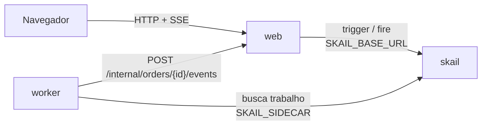

# skail purchase approval (.NET 8)

[English](README.md)

Uma function do skail pede ao gestor a aprovação de uma ordem de compra e espera a decisão até um prazo. Sem resposta, ela escala para a diretoria e espera de novo; sem resposta outra vez, cancela a ordem. Os prazos são de 1 minuto nesta demo e de 48 horas numa aprovação de verdade, com o mesmo código. Uma página web faz o pedido e tem os botões **Approve** e **Reject** para o nível que está aguardando.

A demo mostra três tópicos da [documentação do skail](https://docs.skail.dev):

- um [evento externo](https://docs.skail.dev/construa/conceitos/eventos-externos-e-correlacao) que leva a decisão para a execução;
- o padrão de [espera com prazo](https://docs.skail.dev/construa/como-fazer/esperar-um-evento-com-prazo): o evento ou o delay, o que vier primeiro;
- [human-in-the-loop](https://docs.skail.dev/construa/como-fazer/padroes-e-antipadroes/human-in-the-loop), com escalonamento quando ninguém responde.

## Como funciona



- **worker** (`src/SkailPurchaseApproval.Worker`): a function `ApprovePurchase(purchase, managerDeadlineSeconds, directorDeadlineSeconds)` no `PurchaseFunctions.cs` e os commands dela no `PurchaseCommands.cs`. O `RequestApproval` pede a decisão a um nível; `ConfirmPurchase`, `RejectPurchase` e `CancelForNoResponse` encerram a ordem; o `ReportStatus` avisa a página do andamento da execução. Os commands delegam para o `PurchaseOperations`, então a lógica deles é testada sem o skail.
- **web** (`src/SkailPurchaseApproval.Web`): página estática e API. Inicia a execução (trigger), registra cada decisão do nível que está aguardando e manda para a execução (fire), guarda o estado em memória e transmite para a página (SSE).
- **contracts** (`src/SkailPurchaseApproval.Contracts`): tipos e constantes usados pelo worker e pelo web.

A function só orquestra e deixa o I/O para os commands. Ela cria uma única espera por `PURCHASE_DECISION` e reaproveita essa espera nos dois `WhenAny`, um por prazo. O `WhenAny` devolve a task que terminou primeiro, e a function compara essa task com a espera. O trecho abaixo é uma versão simplificada do [`PurchaseFunctions.cs`](src/SkailPurchaseApproval.Worker/PurchaseFunctions.cs), que também avisa a página de cada etapa:

```csharp
await commands.RequestApproval(purchase, Levels.Manager);
var decision = SkailTask.WaitForEvent<Decision>(Events.PurchaseDecision, purchase.Id);

var winner = await SkailTask.WhenAny(decision, SkailTask.Delay(TimeSpan.FromSeconds(managerDeadlineSeconds)));
if (winner != decision)
{
    await commands.RequestApproval(purchase, Levels.Director);   // escalation
    winner = await SkailTask.WhenAny(decision, SkailTask.Delay(TimeSpan.FromSeconds(directorDeadlineSeconds)));
}

if (winner != decision)
    return await commands.CancelForNoResponse(purchase);

var answer = await decision;
return answer.Approved
    ? await commands.ConfirmPurchase(purchase, answer)
    : await commands.RejectPurchase(purchase, answer);
```

A function decide pela task que o `WhenAny` devolveu, não por `decision.IsCompleted`: numa retomada, o `IsCompleted` já enxerga uma decisão que chegou depois do prazo.

## Os caminhos

A página tem o botão **Request approval** e um card por nível, com **Approve** e **Reject**.

| O que você faz | O que acontece | Resultado |
|---|---|---|
| **Approve** como Manager | aprovada na hora, sem esperar o prazo | **Approved**, com uma referência `PO-…` |
| **Reject** como Manager | recusada, com o motivo digitado | **Rejected** |
| nada por 1 minuto, depois **Approve** como Director | a ordem escala para a diretoria, que aprova | **Approved** |
| nada por 2 minutos | a ordem é cancelada por falta de resposta, o que é diferente de uma recusa | **Cancelled** |

Uma decisão do nível que não está aguardando (o gestor depois do escalonamento), uma segunda decisão ou uma decisão depois do fim recebem `409`. A primeira decisão vale, e nenhum segundo evento é enviado. A contagem regressiva nos cards é só visual: o prazo de verdade é o delay durável no skail, que não segura thread nem processo.

## Como conecta ao skail

| Serviço | Variável | Para quê |
|---|---|---|
| worker | `SKAIL_SIDECAR` | Conecta a function ao seu environment e recebe o trabalho dela. |
| web | `SKAIL_BASE_URL` | Inicia execuções e envia as decisões pela API HTTP do skail. |

Os dois usam os mesmos `SKAIL_WORKLOAD`, `SKAIL_NAMESPACE` e `SKAIL_KEY`. O web faz duas chamadas:

```http
POST {SKAIL_BASE_URL}/api/v1/trigger/{nome}/{versao}/ApprovePurchase/{orderId}
[{"Id": "{orderId}", "Supplier": "Papelaria Central", "Description": "A4 paper reams (50 boxes)", "Amount": 18500}, 60, 60]

POST {SKAIL_BASE_URL}/api/v1/fire/PURCHASE_DECISION/{orderId}
{"Level": "manager", "Approved": true, "By": "Maria", "Reason": null, "At": "2026-11-03T22:00:00+00:00"}
```

`{nome}` e `{versao}` vêm de `SKAIL_WORKLOAD` (`nome:versao`). Os bodies usam os nomes das propriedades como o C# declara. Cada chamada manda a chave em `skail-key` e em `Authorization: Bearer`, mais o header `Skail-namespace`, como descrito em [autenticação](https://docs.skail.dev/referencia/api-http/autenticacao). `429`, `5xx` e erros de rede são repetidos com o mesmo id da ordem. `401` e `403` não são repetidos: confira `SKAIL_KEY` e `SKAIL_NAMESPACE`.

Os dois números no fim do trigger são os prazos, em segundos. Eles são argumentos da function, então entram no histórico da execução e ficam fixos para aquela execução. O web lê os prazos de `APPROVAL_MANAGER_DEADLINE_SECONDS` e `APPROVAL_DIRECTOR_DEADLINE_SECONDS` (60 por padrão); use `172800` para 48 horas.

O navegador nunca chama o skail. Ele só fala com o web, então a chave fica no servidor.

## Requisitos

- SDK do .NET 8
- podman ou docker
- PowerShell 7+ (`pwsh`), só se você usar o `scripts/run.ps1` em vez do `scripts/run.sh`
- Um environment do skail com o workload de `SKAIL_WORKLOAD` cadastrado (`purchaseapproval:v1.0.0` por padrão). O [Quickstart](https://docs.skail.dev/comece-aqui/quickstart) mostra como pedir a conta, criar o environment e cadastrar o workload.
- Um navegador atual (Chrome/Edge 111+, Firefox 113+, Safari 16.2+). A página usa Server-Sent Events, `color-mix()` do CSS e JavaScript moderno.

## Configurar

```bash
cp .env.example .env     # o .env guarda a chave e é ignorado pelo git
```

Preencha `SKAIL_WORKLOAD` (exatamente como está cadastrado no portal), `SKAIL_NAMESPACE`, `SKAIL_KEY`, `SKAIL_SIDECAR` e `SKAIL_BASE_URL` com os valores do seu environment.

Os prazos são do web, então mudar os prazos só pede um reinício do web.

## Rodar com podman ou docker

```bash
scripts/run.sh up        # builda as duas imagens e sobe web + worker
scripts/run.sh logs
scripts/run.sh down
```

`CONTAINER_ENGINE=docker` força o docker. No Windows, ou em qualquer sistema com PowerShell 7+, rode `pwsh scripts/run.ps1 <comando>` com os mesmos comandos; `$env:CONTAINER_ENGINE = "docker"` força o docker.

Abra <http://localhost:8080> e clique em **Request approval**.

### Ver a durabilidade

1. Clique em **Request approval** e espere o card do Manager mostrar **Pending**.
2. Rode `scripts/run.sh kill-worker`. Ele mata o worker com SIGKILL, como numa queda, e o web mantém o estado da página.
3. Espere o prazo do gestor passar com o worker parado e rode `scripts/run.sh start-worker`.
4. O escalonamento acontece quando o worker volta, e o gestor não é consultado de novo.

No portal, abra o [Monitor](https://docs.skail.dev/referencia/portal/monitor) do seu environment e procure pelo id da ordem. A execução lista `ReportStatus` e `RequestApproval`, cada espera como um `WhenAny` com o seu `Delay`, e o command que encerrou a ordem. O `WaitForEvent` do `PURCHASE_DECISION` aparece uma vez só, dentro do primeiro `WhenAny`, porque a function cria essa espera uma vez e reaproveita. As linhas de log dos commands aparecem entre os passos, como `Approval requested from the director: …`. Numa ordem que escalou, o **E2E Duration** passa do prazo do gestor e o **Duration** fica curto, porque as esperas não ocupam o worker. Uma ordem cancelada também aparece como **Completed**, porque a function retorna normalmente; o resultado dela diz como a ordem terminou (`end: "Cancelled"`).

## VS Code

Abra a pasta e aceite as extensões recomendadas (C# Dev Kit).

- `Ctrl+Shift+B` compila, a task *test* roda os testes e as tasks `containers: up/down/logs/kill-worker/start-worker` chamam o `scripts/run.sh`.
- A configuração de debug **Worker + Web** sobe os dois projetos lendo o `.env`, e um breakpoint dentro de um command funciona. Fora de container, o worker acessa o web em `localhost` (`WEB_BASE_URL`, definido no `launch.json`).

## Testes

```bash
dotnet test
```

Os testes unitários cobrem os contratos, as operações por trás dos commands, o estado das ordens (decisão por nível, nível errado, uma decisão só, desfazer quando o evento não foi enviado), as chamadas ao skail (trigger, fire e novas tentativas) e a API web com SSE. Eles não precisam de rede nem do skail. A function em si roda contra o skail, nos testes de ponta a ponta abaixo.

### Testes de ponta a ponta

A pasta `e2e/` tem uma suíte do Playwright que usa a página de verdade no Chromium, o web de verdade e um worker de verdade contra o seu environment do skail (o `.env` desta pasta), com prazos de 10 segundos. Ela cobre aprovação e recusa do gestor, escalonamento com aprovação ou recusa da diretoria (e `409` para o gestor depois disso), cancelamento por falta de resposta, um recarregamento da página no meio de uma ordem, um worker morto enquanto a ordem espera e uma decisão tomada com o worker parado.

A suíte precisa de Node 20 ou mais novo e pnpm 10, além do SDK do .NET 8.

```bash
cd e2e
pnpm install
pnpm exec playwright install chromium   # só na primeira vez
pnpm exec playwright test               # compila a solution e roda a suíte
```

Ela precisa de um workload que nenhum outro worker esteja atendendo: pare os containers (`scripts/run.sh down`) e qualquer outro worker com o mesmo `SKAIL_WORKLOAD` antes de rodar.

## Observações

- O mesmo evento serve aos dois níveis, então uma decisão do gestor que chega depois do escalonamento seria recebida pela segunda espera. O web recusa essa decisão com `409`, mas só enquanto a memória dele está de pé: um evento enviado direto para a API do skail, ou depois de um reinício do web, não passa por essa verificação.
- Depois de um cancelamento, a espera fica sem resposta de propósito, e o web recusa novas decisões com `409`.
- O estado das ordens fica na memória do web. Reiniciar o web perde o histórico da página; a ordem continua rodando no skail, mas o web ignora o andamento de ordens que ele não conhece.
- "Decided by" é texto livre, e a rota `POST /internal/orders/{id}/events`, que o worker chama, não tem autenticação. Para uma demo local isso basta; proteja as duas antes de usar o padrão em produção.
- Workers com o mesmo `SKAIL_WORKLOAD` no mesmo environment dividem as mesmas execuções: use um workload (ou environment) por pessoa.

## Licença

[Apache-2.0](LICENSE)
